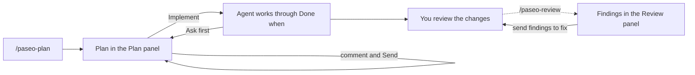

# Paseo plugins

Plugins and agent skills for [Paseo](https://paseo.sh). They add panels for reviewing plans and code, checking agent changes against your own rules, watching subagents, and seeing what fills an agent's context window.

Each folder at the top level is one plugin. The `skills/` folder holds the agent skills that the plan and review panels need.

| Plugin | What it does | Needs |
| --- | --- | --- |
| [`plan-panel`](plan-panel/OVERVIEW.md) | Shows an agent's HTML plan beside it. You comment on any block and send the comments back. When the plan looks right, press Implement and follow the agent's progress in the plan. | Paseo 0.11.4+, `paseo-plan` and `paseo-implement` skills |
| [`review-panel`](review-panel/OVERVIEW.md) | Shows an agent's code review grouped into blocking, should fix, and nitpicks. Each finding opens a diff at the lines it is about. Tick findings and send them back to be fixed. | Paseo 0.11.4+, `paseo-review` skill, a git repository |
| `paseo-rules` | Checks each file an agent changed against rulesets you write in markdown, and lists which rules were followed and which were broken. | Paseo 0.11+, an API key for the judge model |
| `paseo-subagents` | An Explorer panel that lists an agent's subagents with live status, current activity, tool calls, and edits. You can stop one from the list. | Paseo 0.11+ |
| `paseo-context` | An Explorer panel that estimates what fills the selected agent's context window, plus a Context trends screen across sessions and models. | Paseo 0.11+ |

## Install

Plugins are trusted code with no sandbox. The server half runs on your daemon machine and can read files, run processes, and reach the network. Read the source before you install one.

Turn plugins on first, under **Settings → Plugins → Enable plugins**. Then clone the repository on the machine that runs your Paseo daemon, and install each plugin you want from its folder:

```bash
git clone https://github.com/wllnu/paseo-plugins.git
cd paseo-plugins

for plugin in plan-panel review-panel paseo-rules paseo-subagents paseo-context; do
  (cd "$plugin" && npm install && paseo plugin add "$PWD")
done
```

Drop any plugin you don't want from the list. Paseo loads each one from the folder, so keep the clone where it is. Check that they are running:

```bash
paseo plugin ls
```

To update, run `git pull`, then `npm install` in each plugin folder, then `paseo plugin reload <id>`. `paseo plugin remove <id>` uninstalls a plugin and leaves the folder alone, but it deletes the plugin's settings in `~/.paseo/plugin-settings/<id>/`, so back those up before you re-add a plugin from a new folder. `paseo plugin logs <id>` shows the plugin's server output when something fails.

### Skills

The plan and review panels only display files. An agent writes those files, and the skills teach it the format. Symlink the skills into your agent's skills folder, so `git pull` updates them too. For Claude Code:

```bash
for skill in paseo-plan paseo-implement paseo-review write-ruleset; do
  ln -sfn "$PWD/skills/$skill" ~/.claude/skills/$skill
done
```

Other providers use their own folder, such as `~/.agents/skills/`. Don't copy `write-ruleset`: its scripts import from `paseo-rules/` in this repository and break outside it.

| Skill | Used by | What it does |
| --- | --- | --- |
| `paseo-plan` | `plan-panel` | Interviews you about a request, writes a plan (task, guardrails, definition of done) to `.paseo/plans/`, and revises it from your comments until you approve it |
| `paseo-implement` | `plan-panel` | Implements an approved plan until every "Done when" criterion passes its check. It ticks criteria and keeps a progress log in the plan, and uses subagents where the work splits |
| `paseo-review` | `review-panel` | Reviews a change, writes the findings to `.paseo/reviews/`, and fixes the ones you send back |
| `write-ruleset` | `paseo-rules` | Turns a style guide or a loose list of rules into a ruleset the rules check can judge |

## Using them

### Plan, implement, review



1. Ask an agent to plan something, or type `/paseo-plan <what to plan>`.
2. Open the plan with `/plan-panel`, from the Command Center (**⌘K**, Open plan panel), or from the workspace tab bar. Click the handles in the rail on the right to comment on blocks, or select text and comment on that. Press **Send** when you are done. The agent revises the plan and the panel updates.
3. When the plan looks right, press **Implement**. That approves the plan, and the agent works until every "Done when" criterion passes its check. It stops and asks before anything listed under "Ask first".
4. Follow along in the panel. The criterion being worked on is highlighted, finished ones are ticked, and a progress log at the end records the evidence. Nothing gets committed, so every change stays in your working tree.

The **Plans** entry in the sidebar lists plans from all your workspaces.

For a code review, ask an agent to review a branch, commit, PR, or uncommitted changes, or type `/paseo-review <what to review>`. Open the result with `/review-panel`. Tap a file reference to see the diff at those lines, tick the findings you want fixed, and send them.

[plan-panel/OVERVIEW.md](plan-panel/OVERVIEW.md) and [review-panel/OVERVIEW.md](review-panel/OVERVIEW.md) cover the details and limits.

### Rules

Put rulesets in a `.rules/` folder at the root of a repository, or in `~/.config/paseo-rules/` for rules that apply everywhere. A ruleset is one markdown file of rules, each with a severity and a description of when it counts as broken and when it counts as followed. [`paseo-rules/examples/ui.md`](paseo-rules/examples/ui.md) is a complete example, and the `write-ruleset` skill can convert an existing style guide for you.

The plugin adds an index of your rulesets to every new agent's system prompt, so agents see the rules before they edit. After each completed turn it sends every changed file's diff to a judge model, which decides for each rule whether the file followed it, broke it, or the rule does not apply. Results show in the **Rules** Explorer panel. You can send the broken rules back to the agent from there.

Set up the judge under **Settings → Rules**. The defaults point at OpenRouter, so you only need to paste an API key, or set `PASEO_RULES_JUDGE_KEY` in the daemon's environment. The judge URL must use HTTPS because the key goes to it. Turn off the automatic check there if you would rather run **Check rules now** from the Command Center.

The changed code leaves your machine and goes to whichever judge service you configure.

### Subagents and context

Open **Subagents** or **Context** from the Explorer, or search for them in the Command Center.

The context panel shows how much of the window an agent has used and a breakdown by category. For Claude Code agents it reads the session transcript under `~/.claude` (or `CLAUDE_CONFIG_DIR`) to break out the system prompt, tools, skills, and MCP instructions. Other providers get the reported totals without that breakdown. The token counts are estimates. Every finished turn is appended to `~/.paseo-context/sessions.jsonl`, which feeds the trends screen.

## Development

Every plugin is a standalone npm project with no build step. Paseo loads the TypeScript directly.

```bash
cd <plugin>
npm install
npm run typecheck
```

After editing a plugin, typecheck it and run `paseo plugin reload <id>`. You don't need to restart the daemon.

Files ending in `.check.ts` are runnable checks. Run them from the plugin folder with Node 23.6 or later, for example `node server/review.check.ts` inside `paseo-rules/`.

See the [Paseo plugin docs](https://paseo.sh/docs/plugins) for the plugin API.
